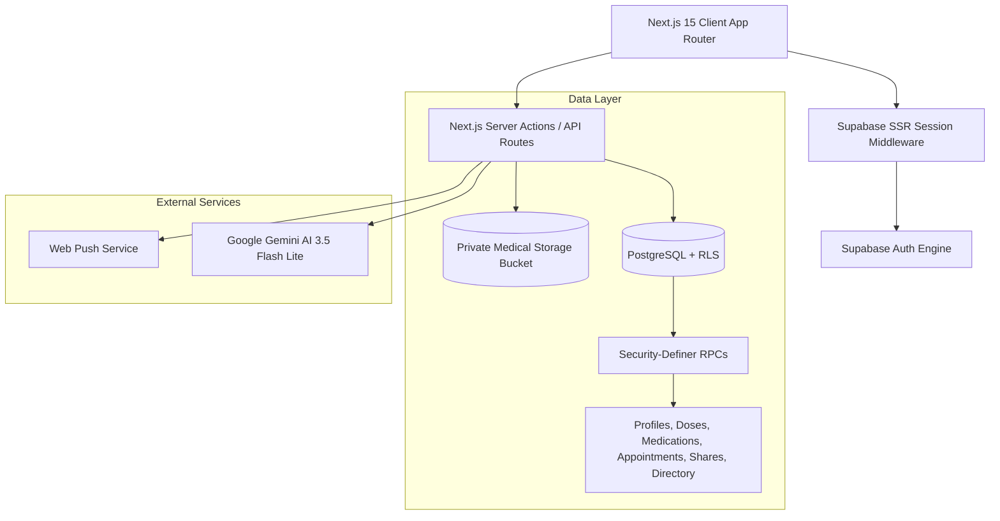

# SaharaCare: Comprehensive Project Technical Audit

## 1. Executive Summary

**Project Name:** SaharaCare  
**Application Type:** Next.js 15 (App Router, React 19) Full-Stack Healthcare & Patient Adherence Platform  
**Primary Target Region & Timezone:** Nepal (`Asia/Kathmandu`)  
**Backend & Persistence:** Supabase (PostgreSQL, Row Level Security, Auth, Realtime, Private Storage)  
**External Services:** Google Gemini API (`@google/genai`), Web Push Notifications (`web-push`)  
**Source Code Location:** `c:\Users\ACER\Documents\Hackathon\saharacare`  
**Current Target Workspace:** `c:\Users\ACER\Downloads\Saharacare-official`

---

## 2. Core Architecture & Technology Stack

### 2.1 Framework & Core Runtime
- **Framework:** Next.js 15.5.24 (App Router)
- **Frontend Library:** React 19.1.0, React DOM 19.1.0
- **TypeScript:** TypeScript 5.7.2 with strict typing
- **Styling & UI:** Tailwind CSS 3.4.17, PostCSS 8.5.24, Radix UI Slot/Dialog, Lucide React icons, Framer Motion
- **Internationalization (i18n):** Native bilingual support (English `en` & Nepali `ne`) with 100% dictionary key parity.

### 2.2 Backend & Data Layer
- **Database:** Supabase PostgreSQL with 22 structured migration files spanning foundational schema, daily dose generation, Realtime replication, role-based security, appointment booking, file sharing, admin directories, and doctor partner networks.
- **Security & Authorization:** Strict PostgreSQL Row Level Security (RLS) on all tables; security-definer RPCs for privileged actions; zero direct client mutations on critical tables (e.g. appointments, doses, notifications).
- **Authentication:** Supabase Auth (Email/Password, Session cookie sync via `@supabase/ssr` middleware, role-based path protection).

### 2.3 External Integrations
- **AI Consultation Assistant:** Google Gemini API via official `@google/genai` SDK with clinical guardrails, safety classifications, Kathmandu-aware urgent emergency triage, and strictly bounded request payloads.
- **Client Document Processing:** Deterministic medical KYC PDF generation and viewing using `pdf-lib` and `pdfjs-dist` (canvas rendering without arbitrary scripting).
- **Push Notifications:** Standard Web Push API via `web-push` and service worker (`public/sw.js`).

---

## 3. Application Features & Domain Modules

### 3.1 Patient Core Experience
1. **Authentication & Role Selection:** Multi-role onboarding (Patient, Caregiver, Doctor, Admin) with role redirection.
2. **Medication Scheduling & Daily Doses:**
   - Patient-owned medication creation with custom schedules (morning, afternoon, evening, night).
   - Automated daily dose materialization in `Asia/Kathmandu` timezone.
   - Dose state transitions: Scheduled -> Taken / Late / Missed with adherence calculations.
3. **Emergency Quick Actions & Offline Contacts:** Hospital shortcuts, ambulance dispatch hotlines, emergency modal.
4. **Patient Medical KYC & Memory-Only Wizard:**
   - 9-step comprehensive medical history questionnaire held exclusively in browser memory.
   - Client-side deterministic PDF report generation.
5. **Caregiver Linking:** Secure 6-character linking code generation, patient approval, and bidirectional monitoring.

### 3.2 Caregiver Monitoring
1. **Patient Monitoring Dashboard:** Real-time visibility into connected patient adherence, upcoming medicines, and missed doses.
2. **Realtime Adherence Updates:** Supabase Realtime websocket subscriptions for instant dose updates.
3. **Notification Center:** Alert dispatch on missed doses, late takes, and urgent events.

### 3.3 Doctor & Appointment Management
1. **Doctor Availability Engine:** Weekly recurring shifts and specific date overrides in Kathmandu timezone.
2. **Safe Slot Generation & Booking:** Deterministic calculation of available slots preventing double-booking via atomic RPCs.
3. **Temporary Medical File Sharing:**
   - Patient grants time-bounded access to doctor for specific appointments.
   - Private Supabase Storage bucket with signed access and server-side revocation / scheduled cron cleanup.
   - Doctor view-only document experience (no print or download controls).

### 3.4 Safe Partner Care Directory & AI Booking Assistant
1. **Verified Partner Directory:** Doctor catalog with verified credentials, specialties, consultation modes, and Kathmandu facilities.
2. **Grounded AI Booking Assistant:** Symptom triage using Gemini with strict emergency escalation floors, paid partner directory isolation, and safe booking handoff.

### 3.5 Administration & Platform Operations
1. **Secure Admin Dashboard:** Verification of partner doctors, clinic oversight, and system metric auditing.
2. **Restricted Admin Surface:** RLS strictly guarantees admins have zero access to patient medical records, files, or dose histories.
3. **Background Cron Jobs:** Automated cleanup of expired medical shares and scheduled medication push reminders.

---

## 4. Dependencies & Relationships Mapping

---

## 5. Main Entry Points & Asset Inventory

### Entry Points
- **HTTP Routing:** Next.js App Router (`app/layout.tsx`, `app/page.tsx`, `app/login`, `app/signup`, `app/patient`, `app/caregiver`, `app/doctor`, `app/admin`)
- **Session Protection:** `middleware.ts` -> `lib/supabase/middleware.ts`
- **Background Workers / Cron:**
  - `app/api/cron/medical-share-cleanup/route.ts`
  - `app/api/cron/medication-reminders/route.ts`
- **Service Worker:** `public/sw.js` (Web push receiver and notification routing)
- **Automated Verification:** `tests/run-tests.ts` (127 passing unit, security, and flow tests)

### Assets & Configuration
- Configuration files: `package.json`, `tsconfig.json`, `tailwind.config.ts`, `postcss.config.mjs`, `components.json`, `vercel.json`
- Localization catalogs: `lib/i18n/en.ts`, `lib/i18n/ne.ts`
- Migrations: 22 PostgreSQL migrations in `supabase/migrations/`

---

## 6. Realistic Development Order & Natural Milestone Phasing

The original commit history and database migrations validate a natural, progressive development lifecycle:

1. **Foundational Platform & UI Baseline:** Core layout, styling, i18n, mock data, and authentication scaffolding.
2. **Medication Management & Caregiver Linking:** Database schema, medication CRUD, atomic dose scheduling, linking codes.
3. **Daily Dose Materialization, History & Realtime:** Kathmandu timezone dose generation, taken/late/missed state machine, caregiver Realtime adherence and notifications.
4. **Medical KYC, Doctor Role & Document Sharing:** 9-step client-only KYC wizard, PDF generation, doctor appointments, private storage and temporary share lifecycle.
5. **AI Consultation Assistant:** Gemini API integration, medical prompt engineering, safety guardrails, rate limiting, and chat contracts.
6. **Platform Administration & Web Push Reminders:** Admin role isolation, directory administration, web push subscription API, service worker notifications.
7. **Doctor Availability & Safe Booking System:** Doctor availability schedules, slot generation, conflict-free atomic booking RPCs, and caregiver booking workflows.
8. **Security Hardening, Enterprise Audit & Responsive Polish:** Request bounding, audit logs, RLS tightening, responsive mobile UX overhaul.
9. **Verified Partner Directory & AI Booking Guidance:** Directory partner search, symptom-guided clinic booking, demo isolation, and final production validation.
