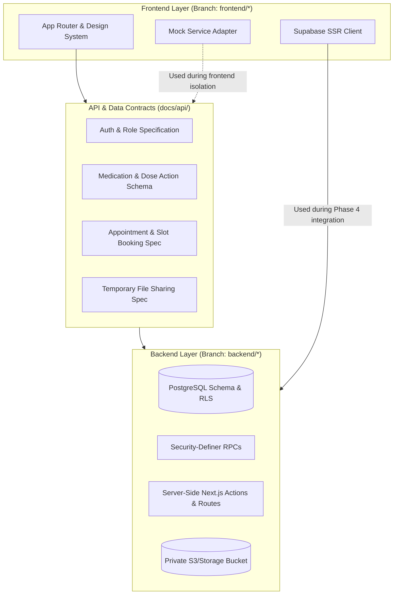

# SaharaCare Architecture & Separation Strategy

## 1. Architectural Overview

SaharaCare is a full-stack, real-time healthcare adherence and patient-caregiver monitoring system designed for the `Asia/Kathmandu` timezone.

To maintain engineering discipline, transparency, and modular stability, development is strictly bifurcated into two decoupled layers:
1. **Backend Layer (Data Models, PostgreSQL RLS, Security-Definer RPCs, Server APIs, Web Push, and AI services)**
2. **Frontend Layer (Next.js 15 App Router, UI design system, bilingual i18n, client state, and interactive workflows)**

Both layers interact through formal, versioned **API and RPC Contracts** documented in [`docs/api/`](file:///c:/Users/ACER/Downloads/Saharacare-official/docs/api/).

---

## 2. Decoupled Development Architecture

---

## 3. Backend-First Progression Plan

Backend reconstruction proceeds in progressive, atomic increments before frontend consumption:

1. **Database Schema & RLS Baseline:**
   - Multi-role user profiles (`patient`, `caregiver`, `doctor`, `admin`).
   - Profile auto-creation triggers on Supabase Auth signup.
   - Restrictive Row Level Security policies.
2. **Medication & Caregiver Linking Engine:**
   - Patient medication plans and custom dosing frequencies.
   - Caregiver 6-character connection codes with patient-mediated approval.
   - Atomic schedule upsert functions.
3. **Daily Dose Materialization & State Machine:**
   - Timezone-aware (`Asia/Kathmandu`) idempotent daily dose generator.
   - Atomic state transitions (`scheduled` -> `taken`, `late`, `missed`).
   - Realtime publication on dose mutations.
4. **Adherence Calculation & Notifications:**
   - Eligible dose filtering and adherence percentage computation.
   - Caregiver notification queue and Realtime broadcast.
5. **Doctor Availability, Slot Engine & Conflict-Free Booking:**
   - Weekly working hours and specific date overrides.
   - Kathmandu slot generator.
   - Conflict-free atomic booking RPCs.
6. **Temporary Medical File Sharing & Revocation:**
   - Private Storage bucket with signed access.
   - Immediate patient-controlled revocation and scheduled cron cleanup.
7. **Clinical AI Consultation Guardrails:**
   - Bounded request parsers, rate limiting, and emergency floor classification.
